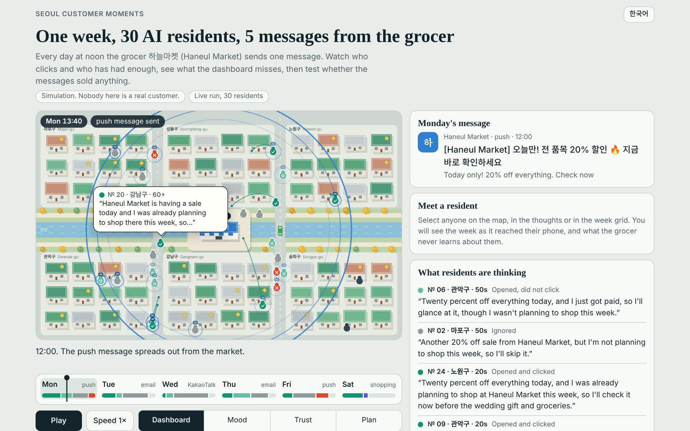

# Seoul Customer Moments

A toy Seoul where every resident is an AI agent with hidden traits. A fictional grocer sends them messages, a real martech stack records what they do, and because the truth is known you can check what the dashboard gets wrong.



**Open the page:** [`docs/`](docs/index.html) (GitHub Pages: `https://whatsupkr.github.io/SCM---Seoul-Customer-Moments/` once Pages is switched on). English and Korean.

**This is a simulation.** No real customer data. It says nothing about real customers.

## What you can do on the page

- **Watch the week.** Five days, one message at noon, each resident reacting through its own model call. Drag the week strip to move through time.
- **Change the lens.** The dashboard view (what the brand records), then three layers the brand never sees: annoyance, trust, shopping plan.
- **Open a resident.** The week as it reached their phone, what they thought, what the grocer never learns about them.
- **Guess, then reveal.** How many of the purchases credited to clicks did the messages really cause?
- **Run your own silence test.** Draw a random silent group, replay the week with it, then repeat the draw 300 times and see how the answers spread around the truth, next to what click attribution says.
- **Send your own message** (Claude artifact version only). Residents react live, one request per resident on the viewer's own Claude account.

## What it is for

In real CRM you never see what would have happened without the message. Here you do: each agent carries a hidden flag, "was going to shop anyway", drawn at random and locked before any message is sent.

So this world is a test bench for **measurement methods**. The truth is known. The question is which method finds it.

First run (30 agents, 5 messages, 12 Nov 2026):

| Method | Purchases credited to the messages |
|---|---|
| Click attribution | 12 |
| The truth | 0 |

Every agent who clicked was already going to shop. Thirty agents is an illustration, not a result: the next run uses 300 agents and a silent control group.

## What is built

- [x] **Join 1** — 30 agents react to 5 messages, each through its own model call (`join1/run.py`)
- [x] **Join 2** — reactions replayed as events: script → Segment → Amplitude (`join2/send_to_amplitude.py`)
- [x] **Measurement check** — clicks vs silent group vs the truth (`join1/measure.py`)
- [x] **Replay page** (`docs/`) with a playable silence test, and tests for both the world and the page (`tests/`)
- [ ] Join 3 — events → BigQuery, SQL models
- [ ] Join 4 — BigQuery → Hightouch → OneSignal
- [ ] Join 5 — message → agent inbox → reaction

## How the world stays fair

- **Hidden traits stay hidden.** Trust, fatigue and "was going to shop anyway" never reach Amplitude. A test fails if they do.
- **The model does not decide who leaves.** It says how annoyed the agent is. Dice anchored on a benchmark decide who actually unsubscribes.
- **Separate dice.** People, the control group and purchases each use their own random stream, so adding a control group changes nobody.
- **Hard caps.** Each run refuses to start above a fixed number of calls. Live runs start by hand only.
- **One source for purchases.** The page reads each resident's purchase from `join1/measure.py`, and a test checks that the page and the report count the same.

## Known limits

- **Built-in answers.** The persona tells the model about the agent's trust and shopping plan, so "loyal agents click more" is true by construction. The world can test a method. It cannot discover customer behaviour.
- **Purchases follow a hand-written rule** (top of `join1/measure.py`).
- **Push opt-out rate is an assumption.** The only public figure found is stated intent (12% after one push a week). Used per message it removed 37% of agents in a week. The default is now a tenth of it, flagged in `agents/fatigue.py`, until an observed rate replaces it.
- **KakaoTalk opt-out rate:** no public benchmark found; set equal to email.
- Population traits are uniform placeholders. Calibration on KOSIS (age, district, household) comes next.
- **On the page**, the map, the daily walks and the Saturday shopping trip are staging. Reactions, thoughts and hidden traits come from the run.

## How the page is made

No build step, no dependency: `docs/index.html`, one stylesheet and seven ES modules.

| File | Role |
|---|---|
| `docs/js/model.js` | The logic, as pure functions: each resident's week, the measurement, the silence test. Tested with `node --test`. |
| `docs/js/city.js` | The map: layout, scenery, residents drawn every frame on a canvas. |
| `docs/js/panels.js` | Week strip, legend, figures, the resident's phone, thoughts, week grid, Saturday question. |
| `docs/js/lab.js` | The silence test and its histogram. |
| `docs/js/live.js` | Live message test, only where the Claude artifact runtime is present. |
| `docs/js/i18n.js` | Every word, in English and Korean. |
| `viewer/build.py` | Writes `docs/data.json` from the latest run. |
| `viewer/bundle.py` | Writes `dist/seoul-customer-moments.html`, the whole page in one file. |

Colours were checked with a palette validator for colour-blind separation, and on the map shape repeats what colour says (a tick for a click, a ring for an open, a cross for an unsubscribe). The page works with a keyboard, follows light and dark themes, respects reduced motion, and only redraws while something moves.

## Run it

```bash
python -m unittest discover tests        # rules of the world and of the page data, no API call
node --test tests/js/model.test.mjs      # rules of the page logic
python join1/run.py --dry-run            # fake reactions, no API call
python join1/measure.py                  # clicks vs truth on the latest run
python viewer/build.py                   # refresh the page data
python -m http.server -d docs 8000       # open http://localhost:8000
python viewer/bundle.py                  # one-file version in dist/
```

Live runs use Claude Haiku from GitHub Actions through Workload Identity Federation: GitHub's short-lived identity token is exchanged for a short-lived Anthropic token, scoped to this repository's `main` branch. There is no API key anywhere.
